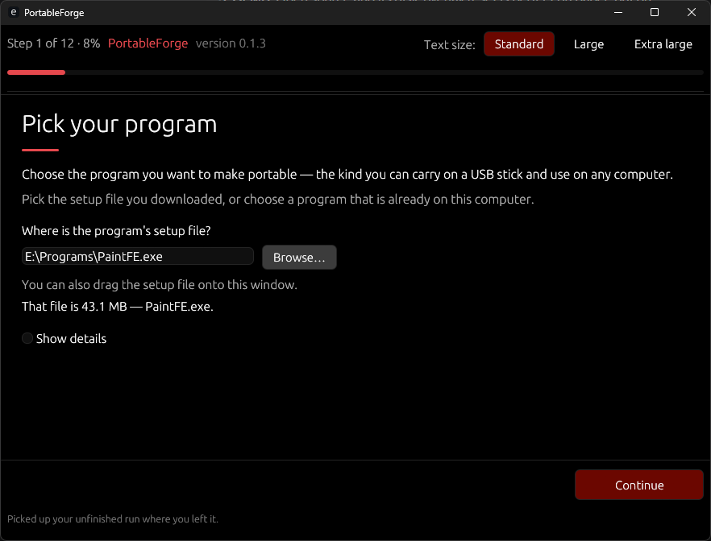
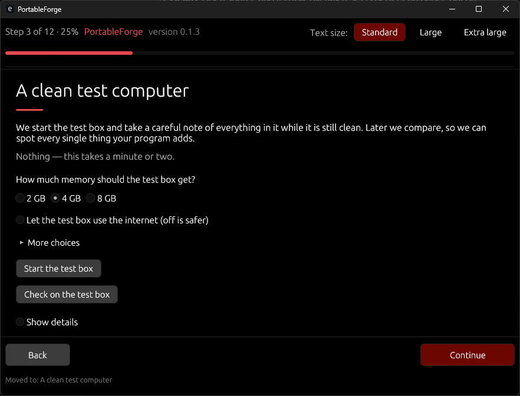
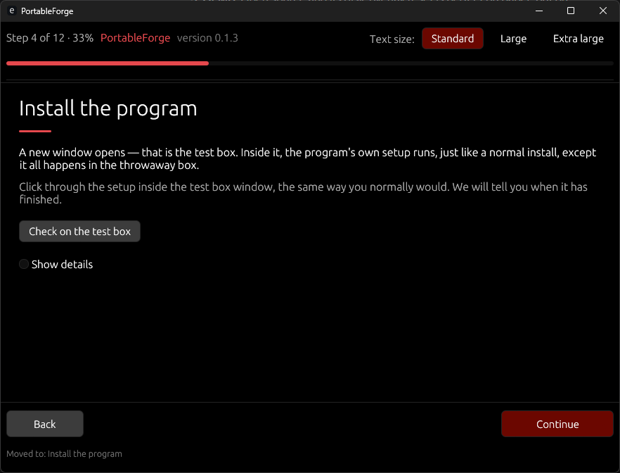
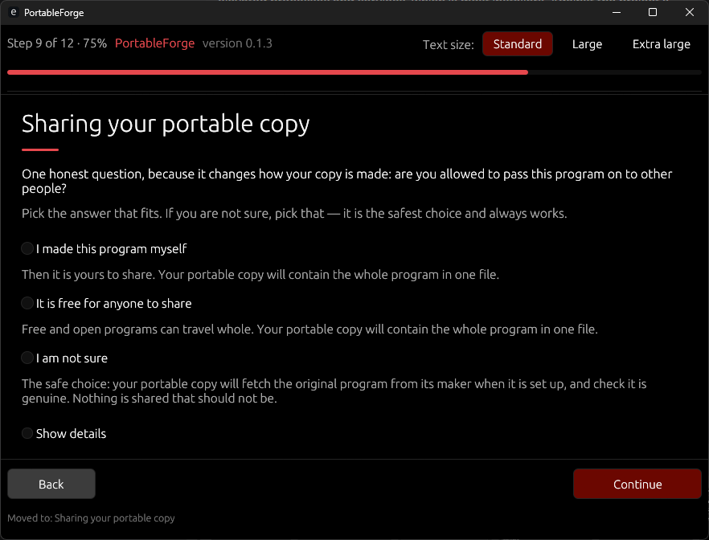
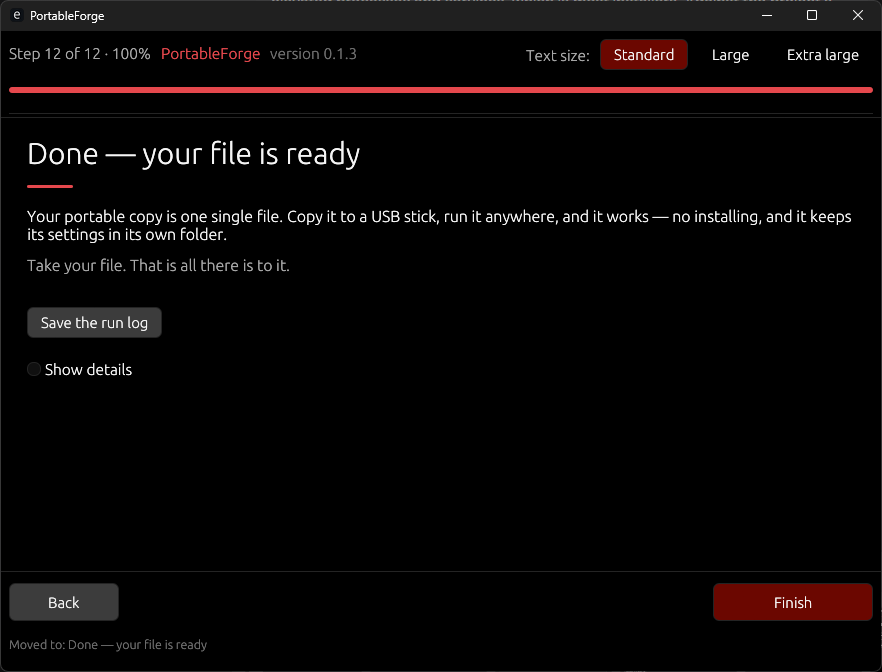

## TL;DR

PortableForge is a PortableApps.com development workspace. Drop a ZIP, unpacked app folder, or a group of files for one app to build a portable installer, or capture a trusted Windows setup in an isolated test box, review the observed files and settings, and prepare the package and its artwork in the wizard. Save the approved package as a reusable profile and build a `.paf.exe` whenever the selected setup matches the original SHA-256.


## Who it is for

The desktop wizard guides capture, review, and packaging. GitHub Dark is the default. **Appearance** also offers System and GitHub Light, plus three text sizes. Use **Commands** or **Ctrl+K** to find an action and **Status and details** for diagnostics.

## What you need

- Windows 10 (build 18342 or newer) or Windows 11. Windows Sandbox is available on Pro, Enterprise, and Education. The verified Sandboxie-Plus workflow supports Windows x64, including Home, with Sandboxie-Plus 1.18.8 x64. Careful mode runs on the host and attempts to restore monitored changes.
- About 2 GB of free disk space and 2 GB of free memory while it works.
- A program whose installer you have, and — only if you plan to share the finished portable copy — the right to share it. PortableForge asks, and builds differently depending on your answer.
- Nothing else. No coding, no accounts, no internet needed after the one-time download of the two official builder programs (PortableForge checks their fingerprints before trusting them).

## What it does for you

- Captures supported changes from a trusted setup and app exercise.
- Shows the exact location and suggested handling for each captured finding.
- Prepares a PortableApps.com Format 3.9 package, or uses a verified profile and the official tools to build a `.paf.exe`.

## How it works

In the standard package flow, select a setup file and review the system checks. Install and try the app in the selected test environment. Close the app and collect the final capture before closing Windows Sandbox. Open **Review Your Package** to see the selected source and next steps. Review captured findings, enter the app details and sharing choice, and prepare the package folder. The wizard displays recorded test results when available.

## Build from a ZIP, app folder, or app files

1. Drop one ZIP or app folder on the first page, or select the files for one app together. For loose files, include the app's executable and its companion files from the same folder. To include subfolders, drop the whole app folder or its ZIP. Setup files still use the capture workflow.
2. In **Guided**, use **Review Your Package** to review the suggested program, name, version, publisher, and icon. Choose the main program if several look plausible. Fill in missing details, confirm permission to include the files, and select the official Launcher Generator 2.2.9 and Installer 3.9.19 folders.
3. Choose a new output folder and build. In **Autonomous**, PortableForge starts the build once the required choices and checks are complete. The installer and build receipt appear together in the output folder.

In **Autonomous**, use **Save for Later** to pause one app package. Choose **Resume App Package** from the first page to scan the original files again and pick up your saved choices. Review the current files and confirm permission to include them before building. Apply custom artwork again after resuming. The saved job stays available after building. Use **Remove Saved Job** to clear it.

ZIP and loose-file staging on Windows x64 leaves your originals intact and never runs them. ZIPs use standard stored or deflated files. If PortableForge cannot open an archive format, extract it with a trusted tool and drop the resulting app folder.

Choose **Test Installer** on the result page to try the new installer in a fresh Sandboxie-Plus box. Follow the prompts to finish setup and try the app twice. The result records what happened to the app’s portable data and whether the test box was removed.

Use **Edit Package Artwork** to change the app icon or the image shown on the left side of the installer. Preview your changes and choose **Apply Artwork** before building.

PortableForge leaves the source folder intact and preserves its directory layout in staging. The official installer builder skips housekeeping files such as `thumbs.db`. It warns about likely fixed paths and parent-folder references in supported settings files. The folder check does not start the app, so the build result reports that portability at runtime is unverified. A prepared PortableApps.com package can use the trusted prepared-package command described below.

## Reuse a reviewed capture in the wizard

1. On the first page choose **Capture with Sandboxie-Plus**. This needs Windows x64 and Sandboxie-Plus 1.18.8 x64. Choose a trusted setup `.exe` that can finish offline without elevation or a restart. In **Setup options**, enter one argument per line and explicitly choose any companion files. Enter the installed app path or leave it blank to pick an app after setup.
2. Use **Check prerequisites**, confirm that you trust the selected inputs and installed app, and choose **Start capture**. If the dedicated box is unavailable, the wizard offers the portable test box folder and setup instructions. Finish setup inside the dedicated box, choose the installed app if prompted, then try and close it. **Cancel capture** requests cleanup of the dedicated box.
3. **Review Your Package** opens after cleanup is confirmed. Choose **Review Findings** to see what changed. **Needs attention** shows unresolved warnings. If you close the wizard after a cleaned capture, **Pick up where I left off** rechecks its saved receipt and opens the review so you can recheck the choices. Captures whose receipts predate the selected app field need a fresh capture to reopen in the wizard.
4. Enter the portable copy's name, publisher, full HTTP or HTTPS homepage, and a short description. Confirm permission to bundle the app. Select the official PortableApps.com Launcher Generator 2.2.9 folder and a new profile folder. To customize the visuals, choose **Edit package artwork…**, then **Apply artwork**. Choose **Save profile** to approve the package.
5. Choose **Build installer**, or choose **Open saved profiles** on the first page later. Select the matching setup, the official PortableApps.com Installer 3.9.19 folder, and a new build folder. The build checks the setup bytes, saved profile approval, staged package, and installer tools before publishing the installer and receipt.

Use printable ASCII for the capture and build paths. Leave out `$`, `%`, single and double quotes, and backticks. Use **Setup options** to pick a capture folder if the default path contains one of these characters.

### Start the bundled portable test box

PortableForge reuses a compatible running Sandboxie-Plus engine for verified capture and installer testing. To start the bundled Sandboxie-Plus 1.18.8 x64 portable files, choose **Open bundled test box folder** and copy the whole folder to a new protected local location under Program Files. Open `SandMan.exe` from that copy and approve its administrator prompts to start the Sandboxie-Plus service and driver. Return to **Capture with Sandboxie-Plus** and choose **Check prerequisites**. After using the portable engine, close SandMan and approve its service cleanup prompt. [Sandboxie-Plus portable startup and cleanup](https://github.com/sandboxie-plus/Sandboxie/blob/v1.18.8/SandboxiePlus/SandMan/SandMan.cpp)

### Customize package artwork

**App icon** previews a PNG or ICO import at the output icon sizes. **Installer left pane** accepts a PNG or ICO, or places the app icon over a chosen background. Use the rotate, flip, Fit and Crop controls to adjust either image. The left pane is 328 × 628 pixels. The editor can restore the captured icon and the default installer pane.

**Apply artwork** keeps the edits in the current wizard session. **Save profile** seals the generated assets with the package, so building it later needs only the saved profile and the usual build inputs.

### Manage profiles and builds

- **Saved profiles** supports searches by name, version, or saved setup fingerprint. **Profile actions** shows the profile and can verify or relocate it. **Capture an update** compares the new capture with the earlier approval before you save a fresh profile.
- **Add to queue** holds an approved build request for this wizard session. **Build queued apps** processes one app at a time. A failed entry keeps its error and any generated working files. Retry it in a fresh output folder.
- **Build results** shows saved builds. **Compare builds** verifies both receipts and displays both installer SHA-256s, input differences, and staged file times before normalization when recorded. **Test installer** verifies the chosen receipt and installer again before opening a dedicated Sandboxie-Plus test box. Follow the prompts to complete setup and try the app twice.

### Capture an MSI in Windows Sandbox

Select a trusted `.msi` in the standard wizard and choose **Check Windows Sandbox**. On a supported Windows edition, choose any companion files in **Setup options**, confirm trust, and start Windows Sandbox. Wait for the clean note, then open the staged MSI inside the guest and finish the guided capture steps. This flow prepares a standard package folder. The reusable profile wizard uses the verified Sandboxie-Plus EXE flow above.

## Safety, in plain words

- Windows Sandbox is a throwaway mini-PC built into Windows 10/11 Pro, Enterprise, and Education. Closing it deletes its contents.
- **Capture with Sandboxie-Plus** checks containment, captures supported redirected writes and scoped settings, and confirms cleanup of the dedicated box before opening the review. Use setups you trust.
- The Windows Sandbox path shares three folders with the box: setup files (read-only), PortableForge's tools (read-only), and the work folder for results. Its internet access is off by default.
- PortableForge itself is offline, collects nothing, and phones nothing home.
- Careful mode runs on the host, monitors supported changes, and attempts to restore them afterward.

## One honest question

Some programs may be shared freely; some may not. PortableForge asks, in plain words, and builds the right kind of copy:

- **Yours, or free to share** → the portable copy contains the whole program.
- **Not sure** → the portable copy fetches the original program from its maker when it is set up, and checks it is genuine before using it.

Your answer is written into the package's notes, so anyone can see which kind of copy it is.

## Built with

- **100% Rust** for everything PortableForge itself is made of — the window, the helper that works inside the test box, and all the thinking in between. No scripts, no second languages to install.
- The official PortableApps.com Launcher and Installer tools are used at the building step (they are separate programs, kept under their own licenses — see the notes inside any package PortableForge makes). They are checked by fingerprint before every use.
- TesselGUI revision 2 uses flat task surfaces, one finding per review page, and a consistent status and action strip. The generated Rust tokens are used under the project's MIT license. [Pinned TesselGUI source](https://github.com/SeanShaffer88/TesselGUI/tree/a689a5e3bfadf9e1e77a3acea826bea5cc717e94)

## Packaging roadmap

The planned workspace puts package tools and icon preparation within reach
of the capture and review steps. Signing and publishing are planned as
explicit actions with user-selected credentials and destinations.

## Command line (optional)

The window guides the capture and review. For scripts and testing, each
step is also a command. The commands below finish installers and reuse
approved captures. Run `portableforge help` for the list.

### Build an installer without clicking through the maker

```powershell
portableforge compile "D:\PortableApps\WidgetPortable" --installer "D:\PortableApps\PortableApps.comInstaller" --out "D:\Builds\widget-run-1" --assert-redistribution
```

Use Windows, a trusted local installation of PortableApps.com Installer
3.9.19, and a trusted, prepared Format 3.9 package with its launcher,
help file and original ICO plus 16px and 32px PNG icons. Set
`Shareable=true` and give `--assert-redistribution` when you may share
everything bundled in the package. This command supports offline
English and Multilingual packages with basic ASCII metadata and either
no `installer.ini` or one with only `[Source]` and optional
`[CheckRunning]` settings. Use a clean prepared copy free of installer
scripts and plugin settings.

Use a new output directory whose parent already exists. The command
checks the four supported tool executables by SHA-256 and relies on the
rest of the selected official installation for templates and compiler
support files. Keep both input directories stable during the build.
Each stage runs from a working copy and has a two-minute deadline.
The `result` folder contains the installer and `build-manifest.json`
after both stages pass and the embedded installer icons match the
original ICO. The `work` folder keeps the staged inputs and
logs for troubleshooting. On timeout, the command requests termination
of its direct child. Check for a remaining compiler process before
retrying in a fresh directory.

The command builds the installer. Installation, upgrades, and the
portable program's behavior are separate checks.

### Capture on Windows Home with Sandboxie-Plus

Use the official Sandboxie-Plus 1.18.8 x64 installation and a trusted
local setup EXE that can install without elevation or a restart. Give
the full path where setup will install the app inside the box, and
choose a new session folder on a local drive.

```powershell
portableforge sandboxie-capture "D:\Setups\widget-setup.exe" --installed-exe "C:\Users\Me\AppData\Local\Widget\Widget.exe" --out "D:\Captures\Widget" --trust-setup
```

Complete setup, try the app when its window opens, and close it. The
optional `--timeout-seconds` sets the time allowed for each of those
two steps. To pass arguments to setup, put them after `--`.
PortableForge verifies the setup process in the new dedicated box
before it starts executing. It uses the exact installed path you chose
to capture the app's folder. The session becomes eligible for
`profile save` after the box's processes, definition and data directory
are confirmed gone. A capture or cleanup error prevents profile save
and identifies the session or box to inspect.

Sandboxie redirects activity on the host. Use a trusted installer and
an installation with configuration permissions for your account.
Capture includes supported redirected local files, current-user
software keys, the machine uninstall keys and service names.
Registry exports stay inside the box temporarily. Session notes retain
only registry entries and service names that changed between stages.
Use `portableforge review "D:\Captures\Widget"` to see the choices
before preparing the package. Save the approved review outside the
box folders. A forced stop can leave the box and its ownership record
for inspection. First-time capture and application
compatibility depend on the host and its Sandboxie configuration.

### Review one Windows Sandbox capture, then rebuild by setup fingerprint

1. Finish the capture in Windows Sandbox or use the verified Sandboxie-Plus
   session above. Save your reviewed choices to a file. Finish preparing the
   package with the launcher, original icons and settings rules you
   reviewed. Keep the captured program files unchanged under
   `App\<BaseAppName>`.
2. Close the test box. Keep the review and package outside the folders
   shared with the box, and leave the session and package files stable.
   Save the profile once, with both approvals.

   ```powershell
   portableforge profile save "D:\Captures\Widget" --review "D:\Review\widget.json" --package "D:\Packages\WidgetPortable" --out "D:\Profiles\Widget" --approve-reviewed-package --assert-redistribution
   ```

   The session must have the three capture notes, the harvested program
   files and one setup file in its `input` folder. The exported choices
   must match the findings in those notes. Use
   `--approve-reviewed-package` to confirm that the finished package
   implements those choices. Captures with red flags need a separate
   packaging review.
3. Save the printed **Profile SHA-256** separately from the profile, for
   example in your build command. To rebuild, pass that saved fingerprint
   and any copy of the same setup file.

   ```powershell
   portableforge profile build "D:\Setups\widget-setup.exe" --profile "D:\Profiles\Widget" --profile-sha256 "<saved profile SHA-256>" --installer "D:\PortableApps\PortableApps.comInstaller" --out "D:\Builds\widget-run-2"
   ```

   The setup file can be renamed or moved. The command reads its bytes to
   match the approved fingerprint and compiles the saved package on
   Windows. The test box is only needed for the first capture. A changed
   setup file, saved review or package requires a new approval. The
   installer and the build record appear under `result` after the same
   compiler and icon checks as `compile`.

The profile contains a copy of the approved package and review. Keep it
private if those contain private data. The saved fingerprint is the
approval record and must come from the trusted save run. Profile checks
bind the recorded capture, exported decisions and copied package
bytes. Capture coverage and runtime portability require their own
verification.

## Screenshots

From a real run on a Windows machine (the remaining captures on
the list in [docs/screenshots/CAPTURE.md](docs/screenshots/CAPTURE.md)
are added as the run-through reaches them):

**Step 1 — Pick your program.** The setup file is chosen; its
size is confirmed in plain words before anything runs.



**Step 3 — A clean test computer.** How much memory the test box
gets, and whether it may use the internet or the clipboard.



**Step 4 — Install the program.** The program's own setup runs
inside the throwaway box, exactly like a normal install.



**Step 9 — Sharing your portable copy.** One honest question,
because it changes how the copy is made.



**Step 12 — Done.** Your file is ready: one file, take it
anywhere.



## Downloading a release

Releases live on this project's GitHub releases page. (Version
1.0.0 comes once the on-machine runbook in
`docs/ON_MACHINE_RUNBOOK.md` has passed; the 0.1.x releases are
the same program, honestly labelled as not yet field-proven.)

Every release has exactly two downloads:

- **The installer** (`PortableForge-Setup-v…-x64.exe`) — a normal
  per-user install, no admin needed, with a Start menu shortcut.
  It installs both programs together; the helper belongs beside
  the main program.
- **The portable zip** (`PortableForge-v…-portable.zip`) — unzip
  anywhere and run `portableforge.exe` from the folder. Keep
  `portableforge-agent.exe` beside it; the helper is needed inside
  the test box. A short `PORTABLE.txt` inside the zip says the
  same in fewer words.

New release packages carry the extracted Sandboxie-Plus 1.18.8 x64
portable files under `bundled/Sandboxie-Plus`. The folder contains the
vendor manager, engine files, and applicable notices. Opening this
folder from PortableForge shows the files in Explorer.

**Check your download is genuine.** The release notes list a
fingerprint (a long line of letters and numbers) for each file.
Compare it with your copy: open PowerShell in the folder where
the file is and run `Get-FileHash .\<the file's name>` — the
`Hash` line it prints must match the one in the release notes,
letter for letter. If it does not match, delete the file and
download it again from the releases page.

The programs are **unsigned**, so Windows SmartScreen will warn
the first time you run one. That is expected; once your
fingerprint check matches, "More info" → "Run anyway" is the
honest way through.

## Building from source

```sh
cargo test --locked        # the full test set — always run it all
cargo build --locked --release
```

Two programs come out: `portableforge` (the window + commands) and `portableforge-agent` (the helper that runs inside the test box).

## Status

The full flow is wired end to end and tested off-Windows: the helper in the test box takes the before / after-install / after-trying-out notes itself (the window or the `request-snapshot` command asks, it answers and copies the program files out), the review feeds a build pipeline that generates the package with the accepted fixes, copies in the harvested program and first-run settings, and validates the finished tree — from the window's build button or the `build` command. What remains unverified is the live run on a real Windows machine (starting the test box, the helper's in-box capture, and the two official builder programs making the final single file) — see `docs/ON_MACHINE_RUNBOOK.md`. Nothing here claims to be verified on Windows until it has actually been run on one.

## License

MIT — see [LICENSE](LICENSE). Copyright 2026 Sean Shaffer.

The PortableApps.com Launcher and Installer are separate programs used at the building step and remain under their own licenses.
