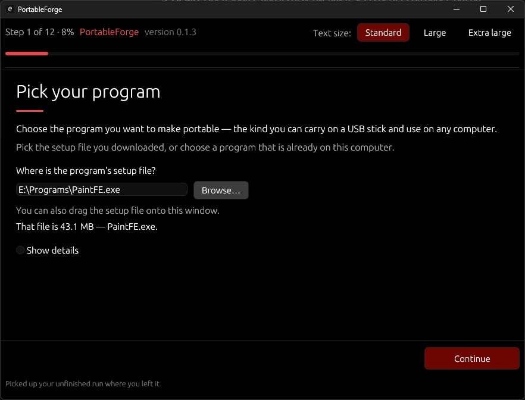
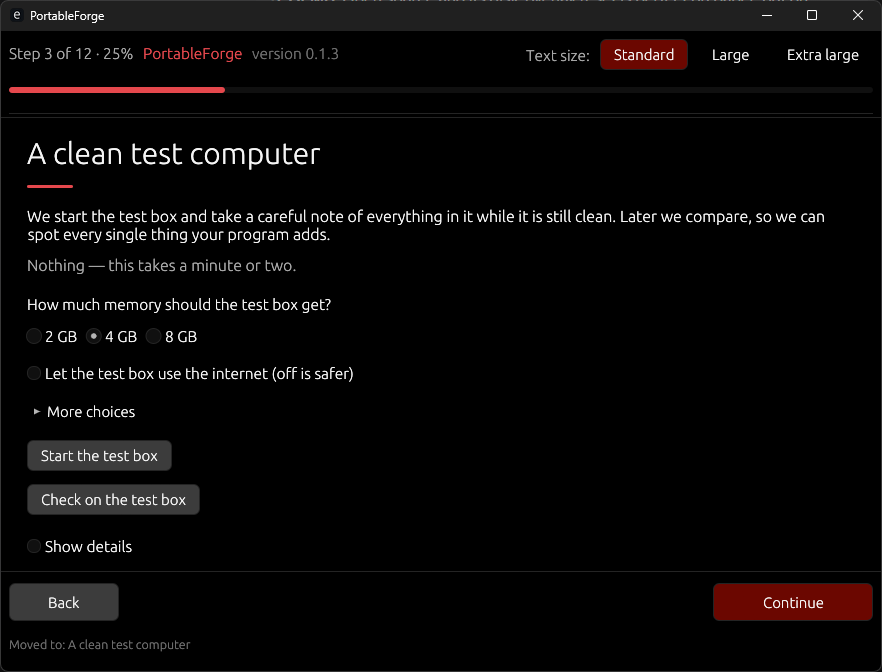
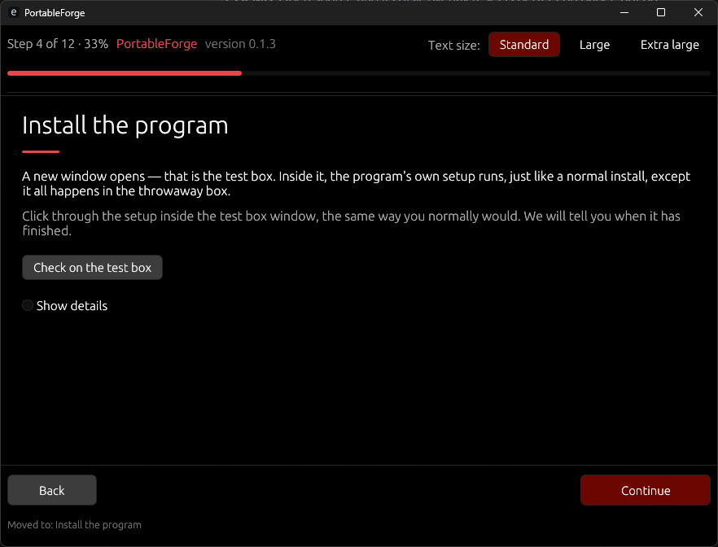

## TL;DR

PortableForge turns a normal Windows program into a **portable** one — a single file you can put on a USB stick, run on any computer, and take your settings with you. It does the whole job for you, step by step, in plain language. You never write code, never edit settings files, and the program you are converting is only ever installed inside a **throwaway test box on your computer that is deleted afterwards — your real computer is never touched by it.**

Pick a program → install it inside the safe box → try it → close it → PortableForge spots everything it left behind and fixes it → you get the finished portable copy. That is the whole experience.


## Who it is for

Anyone. The whole program is one guided path with twelve plain steps, one decision at a time, with sensible choices already made for you. Technical details exist, but they hide behind a "Show details" switch you never need to open. Dark window, large clear text, every button explains itself.

## What you need

- A Windows 10 (build 18342 or newer) or Windows 11 computer. The safe test box needs the Pro, Enterprise, or Education edition — on Home, PortableForge offers Careful mode and says plainly that it is watched-and-reverted, not sealed off.
- About 2 GB of free disk space and 2 GB of free memory while it works.
- A program whose installer you have, and — only if you plan to share the finished portable copy — the right to share it. PortableForge asks, and builds differently depending on your answer.
- Nothing else. No coding, no accounts, no internet needed after the one-time download of the two official builder programs (PortableForge checks their fingerprints before trusting them).

## What it does for you

- Walks you through twelve plain-language steps, start to finish, with a progress bar and a Back button that always works.
- Tests the program inside a throwaway test box, so a bad installer cannot hurt your real computer.
- Works out where the program keeps its settings and files, and shows you each finding as a plain card you can accept or question.
- Builds the portable package to the current PortableApps.com Format (3.9). The official builder programs can then make the final single file from it, when you ask (`portableforge tools run-installer`).
- Tests the finished copy in a fresh box and tells you honestly whether it left anything behind.

## How it works

1. **Pick your program** — its setup file, a download link, or a program already installed.
2. **Safety check** — PortableForge confirms your computer can run the safe test box.
3. **A clean test computer** — it notes everything in the clean box.
4. **Install the program** — inside the box, never on your real computer.
5. **Try it out** — use it for a moment and change a setting, so we can see where it keeps them.
6. **Close the program** — we watch until it has fully closed.
7. **What it left behind** — a short plain-language list of what the program added, with the fix we suggest for each.
8. **Name your portable copy** — mostly filled in for you.
9. **Sharing your portable copy** — one honest question about whether you may pass the program on. Not sure is a perfectly good answer and picks the safest way automatically.
10. **We build it for you** — the finished package, made to the PortableApps.com Format (version 3.9).
11. **Testing the finished copy** — a brand-new test box tries your copy and reports anything it leaves behind.
12. **Done** — take your file.

## Safety, in plain words

- The conversion install happens **only** inside Windows Sandbox, a throwaway mini-PC built into Windows 10/11 (Pro, Enterprise, or Education editions). Closing it deletes everything in it.
- Only three folders are shared with the box: where the setup file lives (read-only), PortableForge's own tools (read-only), and one work folder where the results come out.
- No internet inside the box unless you turn it on for that run.
- PortableForge itself is offline, collects nothing, and phones nothing home.
- On Windows Home, where the test box is not available, PortableForge offers a careful mode that works on your real computer and puts everything back afterwards. It tells you plainly that this mode is **not** sealed off, and it never pretends otherwise.

## One honest question

Some programs may be shared freely; some may not. PortableForge asks, in plain words, and builds the right kind of copy:

- **Yours, or free to share** → the portable copy contains the whole program.
- **Not sure** → the portable copy fetches the original program from its maker when it is set up, and checks it is genuine before using it.

Your answer is written into the package's notes, so anyone can see which kind of copy it is.

## Built with

- **100% Rust** for everything PortableForge itself is made of — the window, the helper that works inside the test box, and all the thinking in between. No scripts, no second languages to install.
- The official PortableApps.com Launcher and Installer tools are used at the building step (they are separate programs, kept under their own licenses — see the notes inside any package PortableForge makes). They are checked by fingerprint before every use.
- Dark theme in PortableForge's black-and-red family colours.

## Command line (optional)

You never need this — the window does everything. For scripts and testing, every step is also a command: `portableforge guide`, `snapshot`, `diff`, `wsb`, `generate`, `validate`, plus the end-to-end ones — `launch`, `request-snapshot`, `post-capture`, and `build` (session notes + package details → a finished, checked package folder). Run `portableforge help` for the list.

## Screenshots

From a real run on a Windows machine (the remaining captures on
the list in [docs/screenshots/CAPTURE.md](docs/screenshots/CAPTURE.md)
are added as the run-through reaches them):

**Step 1 — Pick your program.** The setup file is chosen; its
size is confirmed in plain words before anything runs.



**Step 3 — A clean test computer.** How much memory the test box
gets, and whether it may use the internet or the clipboard.



**Step 4 — Install the program.** The program's own setup runs
inside the throwaway box, exactly like a normal install.



## Downloading a release

Releases live on this project's GitHub releases page. (Version
1.0.0 comes once the on-machine runbook in
`docs/ON_MACHINE_RUNBOOK.md` has passed; the 0.1.x releases are
the same program, honestly labelled as not yet field-proven.)

Every release has exactly two downloads:

- **The installer** (`PortableForge-Setup-v…-x64.exe`) — a normal
  per-user install, no admin needed, with a Start menu shortcut.
  It installs both programs together; the helper belongs beside
  the main program.
- **The portable zip** (`PortableForge-v…-portable.zip`) — unzip
  anywhere and run `portableforge.exe` from the folder. Keep
  `portableforge-agent.exe` beside it; the helper is needed inside
  the test box. A short `PORTABLE.txt` inside the zip says the
  same in fewer words.

**Check your download is genuine.** The release notes list a
fingerprint (a long line of letters and numbers) for each file.
Compare it with your copy: open PowerShell in the folder where
the file is and run `Get-FileHash .\<the file's name>` — the
`Hash` line it prints must match the one in the release notes,
letter for letter. If it does not match, delete the file and
download it again from the releases page.

The programs are **unsigned**, so Windows SmartScreen will warn
the first time you run one. That is expected; once your
fingerprint check matches, "More info" → "Run anyway" is the
honest way through.

## Building from source

```sh
cargo test --locked        # the full test set — always run it all
cargo build --locked --release
```

Two programs come out: `portableforge` (the window + commands) and `portableforge-agent` (the helper that runs inside the test box).

## Status

The full flow is wired end to end and tested off-Windows: the helper in the test box takes the before / after-install / after-trying-out notes itself (the window or the `request-snapshot` command asks, it answers and copies the program files out), the review feeds a build pipeline that generates the package with the accepted fixes, copies in the harvested program and first-run settings, and validates the finished tree — from the window's build button or the `build` command. What remains unverified is the live run on a real Windows machine (starting the test box, the helper's in-box capture, and the two official builder programs making the final single file) — see `docs/ON_MACHINE_RUNBOOK.md`. Nothing here claims to be verified on Windows until it has actually been run on one.

## License

MIT — see [LICENSE](LICENSE). Copyright 2026 Sean Shaffer.

The PortableApps.com Launcher and Installer are separate programs used at the building step and remain under their own licenses.
